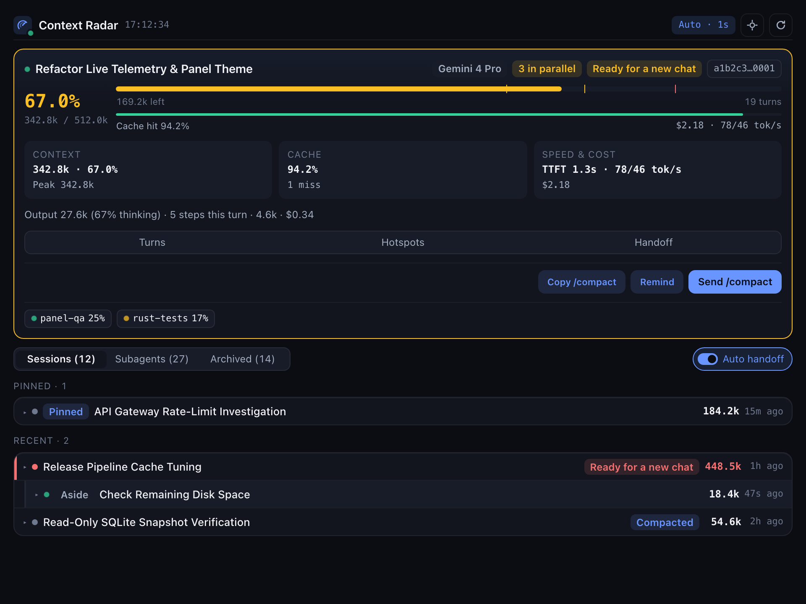

<div align="center">


# Context Radar (`context-radar-mcp`)

**Know how full your context is before it bites.**

Context Radar shows token use, cache hits, and cost for every Antigravity session and subagent, live in the sidebar. When a chat is getting full, it tells you whether to `/compact` or start fresh — and writes the handoff note for you.

[Homepage](https://contextradar.eatingdream.dev) · **English** | [简体中文](README.zh-CN.md) · [Releases](https://github.com/eatingDream-antigravity-plugins/context-radar/releases) · [AI Guide](docs/ai-guide.md) · [`llms.txt`](llms.txt)

[](https://github.com/eatingDream-antigravity-plugins/context-radar/actions/workflows/ci.yml)
[](https://github.com/eatingDream-antigravity-plugins/context-radar/releases)

[](LICENSE)

<br>

<picture>
  <source media="(prefers-color-scheme: dark)" srcset="docs/images/contextradar-overview-dark.png">
  <source media="(prefers-color-scheme: light)" srcset="docs/images/contextradar-overview-light.png">
  
</picture>

</div>

## Is It For You?

- **Yes, if** you run long multi-turn or multi-subagent sessions in Antigravity and want to spot sudden latency spikes, cache misses, and token bloat before hitting the context wall.
- **No, if** you mostly ask short one-off questions that finish well under half the context window—Antigravity's defaults already cover that without an extra side panel.

## What You Get

| | |
| :--- | :--- |
| **Live headroom & subagent view** | Track remaining context tokens, running/waiting/error states, thinking-to-reply ratio, streaming speed, and estimated cost across main sessions and docked subagents. |
| **Clear answers when turns slow down** | Pinpoint whether a slow turn came from normal growth, a mid-loop cache drop (TTL expiry, replica spillover, or model switch), or a post-compact rebuild—and catch cross-model `/compact` cache resets. |
| **Trim bloat without breaking cache** | Spot which exact turns spiked your context and save a concise digest to `scratch/` out-of-band so your active prompt cache stays hot. |
| **Compaction only when it pays off** | Check budget thresholds, active subagents, and break-even turns before running `/compact` or handing off to a fresh chat, with automatic CLI support for unattended runs. |
| **100% local & read-only** | Runs as a single native Rust binary with zero outbound network calls, zero telemetry, and read-only access to Antigravity's local session logs. |

## Quick Start

```sh
curl -fsSL https://raw.githubusercontent.com/eatingDream-antigravity-plugins/context-radar/main/scripts/install.sh | sh
```

<sub>Verifies the release archive SHA-256 automatically · Refreshes MCP servers automatically inside Antigravity (use `--reload` outside or `--no-reload` to skip) · Supports macOS (Apple Silicon & Intel) and Linux `x86_64` · Pin a tag with `CONTEXT_RADAR_VERSION=vX.Y.Z` · Remove cleanly anytime with `... | sh -s -- --uninstall`.</sub>

Reload Antigravity, open **Context Radar** in the side pane, or ask your agent:

- *"Why did the last few turns get slow?"*
- *"Which turns bloated this session, and is it worth running `/compact` now?"*

### 30-Second Local Demo

Check your live local telemetry latency or inspect the built panel offline right from the terminal:

```sh
~/.gemini/config/plugins/context-radar-mcp/bin/context-radar-mcp bench --iterations 5
```

Or from a source checkout:

```sh
npm --prefix panel ci --ignore-scripts && npm --prefix panel run build && open panel/dist/panel.html
```

## For AI Agents

Context Radar ships machine-readable docs and a portable skill (`agentskills.io` compatible) for Antigravity, Claude Code, Codex, Cursor, and OpenCode:

```sh
npx skills add eatingDream-antigravity-plugins/context-radar
```

> **Agent hint**: Read [`llms.txt`](llms.txt), [`skills/context-radar/SKILL.md`](skills/context-radar/SKILL.md), and [`docs/ai-guide.md`](docs/ai-guide.md) for MCP tool schemas, headless ACP workflows, settings, and source builds.

## Safety & Privacy

- **Zero network & zero telemetry**: Reads local Antigravity ledgers in read-only mode and never transmits prompts, paths, or metrics off your machine.
- **Symlink-safe local writes**: Out-of-band `scratch/` digests and single-use handoff grants are scoped to the active conversation and workspace with owner-only (`0600`) atomic writes.
- **Self-contained panel UI**: Single offline HTML bundle with strict `default-src 'none'` CSP, zero external requests, and zero `innerHTML` writes.

## Documentation

- [AI Agent & Operator Guide](docs/ai-guide.md) — Full MCP tool schemas, ACP `acp-proxy` / `acp-run`, settings & env vars, source build
- [Portable Agent Skill (`SKILL.md`)](skills/context-radar/SKILL.md) · [LLM Index (`llms.txt`)](llms.txt)
- [Settings Example](settings.example.json) · [Contributor Guide](AGENTS.md) · [Changelog](CHANGELOG.md) · [Security](SECURITY.md) · [Contributing](CONTRIBUTING.md)

## Antigravity Plugin Suite

Part of the [Antigravity Plugins](https://github.com/eatingDream-antigravity-plugins) suite: **Context Radar** · [Clam Guard](https://github.com/eatingDream-antigravity-plugins/clam-guard) · [Remote Cast](https://github.com/eatingDream-antigravity-plugins/remote-cast) · [Colab Deck](https://github.com/eatingDream-antigravity-plugins/colab-deck) · [Panel Kit](https://github.com/eatingDream-antigravity-plugins/panel-kit).

## License

Licensed under the [MIT License](LICENSE).
