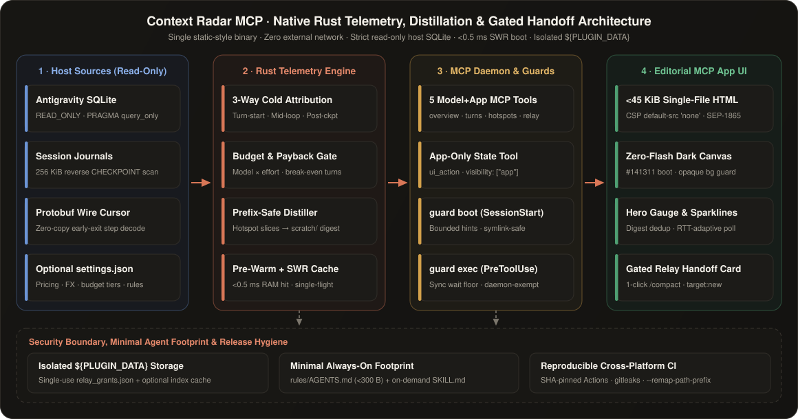

<div align="center">


# Context Radar MCP

**Native Rust Antigravity context telemetry, 3-way cold-cache attribution, prefix-safe slice distillation, gated `/compact` & `target:new` relay handoffs, and execution guards.**

[](https://github.com/eatingDream-antigravity-plugins/context-radar-mcp/actions/workflows/ci.yml)
[](https://github.com/eatingDream-antigravity-plugins/context-radar-mcp/releases)
[](LICENSE)


English | [简体中文](README.zh-CN.md)


<sub>Single native Rust binary with zero runtime dependencies, strict read-only host SQLite access, and a dark-first &lt; 45 KiB SEP-1865 MCP App panel.</sub>

</div>

## Features

- **Instant Startup Pre-Warm & `< 0.5 ms` SWR**: A background thread pre-loads `panel/dist/panel.html` and warms active host SQLite telemetry into memory on daemon boot. `resources/read` and `context_radar_overview` serve cached SSR boot payloads immediately via Stale-While-Revalidate with single-flight background refresh.
- **3-Way Cold-Cache Attribution**: Classifies every KV cache miss into `turn_start_cold` (new user turn), `mid_loop_cold` (unexpected prefix break inside an agent loop), or `post_compact_cold` (expected first turn after compaction) alongside TTFT, stream throughput (tok/s), and estimated turn cost.
- **Prefix-Safe Slice Distillation**: Uses 256 KiB reverse `CHECKPOINT` scanning (`context_radar_hotspots`) to pinpoint the highest-growth historical steps and distill bloated ranges into `< 600` token digests persisted to the session `scratch/` directory without invalidating the live KV cache prefix.
- **Hard-Gated `/compact` & Official `target:new` Handoffs**: Evaluates model × reasoning-effort budget tiers, cooldown turns since the last checkpoint, recent cold-rebuild protection, `running_subagent_count == 0`, and economic break-even turns before issuing single-use replay-protected handoff grants (`context_radar_prepare_handoff` → `context_radar_commit_handoff`).
- **Editorial-Warm Dark-First MCP App UI (`ui://context-radar-mcp/panel`)**: Self-contained `< 45 KiB` HTML bundle (`default-src 'none'`, zero external URLs) with `#141311` frame-0 dark canvas, transparent `--color-background-primary` rejection, live Antigravity theme sync, hero context gauge, per-turn sparklines, digest-deduped polling, and RTT-adaptive weak-network cadence.
- **Native Rust Execution Guards (`hooks.json`)**: Zero-overhead `SessionStart` (`guard boot`) workspace state summarizer with symlink/path-traversal protection and `PreToolUse(run_command)` (`guard exec`) wait-floor guard that automatically exempts `IsDaemon: true`, `&`, `nohup`, watchers, and dev servers.
- **Minimal Always-On Footprint**: Plain-markdown `rules/AGENTS.md` (`< 300 B`), on-demand `skills/context-radar/SKILL.md`, and strictly app-only `context_radar_ui_action` (`_meta.ui.visibility: ["app"]`).

## Architecture

<p align="center"></p>

1. **Host Sources (Read-Only)**: Antigravity SQLite databases are opened exclusively with `SQLITE_OPEN_READ_ONLY` + `PRAGMA query_only = ON`; conversation journals are tailed in reverse from the latest `CHECKPOINT` and parsed via a zero-copy early-exit protobuf wire cursor (`src/wire/pb_cursor.rs`).
2. **Rust Telemetry Engine (`src/engine/`)**: Computes 3-way cold-cache breakdowns, model × effort budget tiers, economic break-even turns, prefix-safe slice digests, and maintains the pre-warmed SWR cache.
3. **MCP Daemon & Guards (`src/rpc/`, `src/guard/`)**: Serves JSON-RPC stdio tools (`daemon`), isolates writable state (`relay_grants.json`, optional `index_cache.sqlite`) strictly inside `${PLUGIN_DATA}`, and provides sub-millisecond CLI hooks (`guard boot`, `guard exec`).
4. **Editorial-Warm MCP App UI (`panel/`)**: Packs `bridge.js`, `view.js`, and `theme.css` into a single `< 45 KiB` HTML resource with synchronous SSR boot hydration, in-place DOM patching, capability-gated controls, and transparent-background guards.

## Quick Install

### One-line install (macOS & Linux)

Downloads the matching prebuilt release archive from GitHub Releases, verifies its SHA-256 checksum, and installs into `${ANTIGRAVITY_PLUGINS_DIR:-$HOME/.gemini/config/plugins}/context-radar-mcp`:

```sh
curl -fsSL https://raw.githubusercontent.com/eatingDream-antigravity-plugins/context-radar-mcp/main/scripts/install.sh | sh
```

Pin a specific release tag or custom plugin directory if desired:

```sh
CONTEXT_RADAR_VERSION=v1.0.0 ANTIGRAVITY_PLUGINS_DIR=~/.gemini/config/plugins \
  curl -fsSL https://raw.githubusercontent.com/eatingDream-antigravity-plugins/context-radar-mcp/main/scripts/install.sh | sh
```

Supported release targets: `aarch64-apple-darwin`, `x86_64-apple-darwin`, and `x86_64-unknown-linux-gnu`.

### Build from source

Requirements: Rust toolchain (`cargo`), Node.js 20+ (only needed to repack `panel/dist/panel.html` and run panel tests).

```bash
git clone https://github.com/eatingDream-antigravity-plugins/context-radar-mcp.git
cd context-radar-mcp

# Bundle self-contained MCP App panel (< 45 KiB) & run panel tests
node panel/pack.mjs
node --test panel/panel.test.mjs

# Run Rust unit, security, SWR, and stdio E2E tests
cargo test --locked

# Build stripped LTO release binary without embedding local home paths
RUSTFLAGS="--remap-path-prefix=$HOME=/build" cargo build --release --locked

# Optional: run built-in telemetry, protobuf, and guard micro-benchmark
./target/release/context-radar-mcp bench
```

## Agent Integration & Skill

Context Radar MCP follows the minimal-intrusion Antigravity plugin architecture:

- **`rules/AGENTS.md`** (`< 300 B`, plain markdown): Always-on pointer telling the agent what Context Radar monitors and when to load the skill.
- **`skills/context-radar/SKILL.md`**: On-demand playbook covering KV-cache prefix hygiene, slice distillation, hard-gated handoff boundaries, subagent baton passes, and `run_command` wait etiquette.
- **`hooks.json`**: Wires `context-radar-mcp guard boot` (`SessionStart`, silent `{}` when unconfigured) and `context-radar-mcp guard exec` (`PreToolUse` on `run_command`).

### MCP Tools

| Tool | Visibility | Purpose |
| :--- | :--- | :--- |
| `context_radar_overview` | Model + App (`aux_pane`, `global`) | Live session/subagent snapshot, `if_digest` dedup, SWR boot entrypoint (`ui://context-radar-mcp/panel`) |
| `context_radar_turns` | Model + App | Per-turn context tokens, cache hit %, 3-way cold-cache attribution, TTFT, tok/s, and turn cost |
| `context_radar_hotspots` | Model + App | 256 KiB reverse `CHECKPOINT` scan to locate bloat hotspots or distill slices to `scratch/` |
| `context_radar_prepare_handoff` | Model + App | Model × effort budget tier, cooldown, running subagent check, and break-even payback evaluation |
| `context_radar_commit_handoff` | Model + App | Server-side hard-gated single-use grant issuance, 1-click `/compact`, and `target:new` card (`ui://context-radar-mcp/handoff`) |
| `context_radar_ui_action` | App only (`["app"]`) | Panel preference persistence (`set_prefs`) and grant lifecycle (`claim_grant`, `record_relay`, `dismiss_grant`) |

## Configuration

No user config file is required or created by default. To customize model pricing, currency/FX rate, budget tiers, or workspace boot/exec guards, copy [settings.example.json](settings.example.json) to `~/.config/context-radar-mcp/settings.json` (validated against [settings.schema.json](settings.schema.json)).

| Environment Variable | Description | Default |
| :--- | :--- | :--- |
| `CONTEXT_RADAR_CONFIG` | Path to custom `settings.json` (set to `none`/`off` to disable) | `~/.config/context-radar-mcp/settings.json` |
| `CONTEXT_RADAR_DATA_ROOT` | Host Antigravity data root (read-only telemetry source) | `~/.gemini/antigravity` |
| `CONTEXT_RADAR_PLUGIN_DATA` | Isolated writable plugin data directory (`--data-dir` overrides) | `${DATA_ROOT}/plugin_data/context-radar-mcp` |
| `CONTEXT_RADAR_DISABLE_DISK_CACHE` | Disable optional `index_cache.sqlite` under plugin data dir | unset (`false`) |
| `CONTEXT_RADAR_PANEL_HTML` | Override path to `panel/dist/panel.html` (`--panel-html` overrides) | `${PLUGIN_ROOT}/panel/dist/panel.html` |

## Security & Privacy Boundary

- **Strict read-only host inspection**: Every Antigravity SQLite database is opened with `SQLITE_OPEN_READ_ONLY` and `PRAGMA query_only = ON`. Context Radar never writes to or locks host conversation DBs.
- **Isolated writable state**: Single-use replay-protected handoff grants (`relay_grants.json`) and the optional local index cache live exclusively under `--data-dir ${PLUGIN_DATA}`.
- **Zero telemetry & zero network**: The binary makes no outbound HTTP/DNS calls, and the embedded MCP App panel enforces `default-src 'none'` with zero external URLs or scripts.
- **Path-traversal & symlink guard**: `guard boot` canonicalizes configured workspace state files and rejects any symlink or relative path escaping the workspace root, enforcing strict byte limits.
- **Supply-chain & binary hygiene**: Release binaries are built with `RUSTFLAGS="--remap-path-prefix=$HOME=/build"`, third-party GitHub Actions are pinned to 40-char commit SHAs, and CI runs full-history `gitleaks` plus `scripts/check_sanitized.sh`.

## Project Structure

```text
context-radar-mcp/
├── src/
│   ├── engine/             # telemetry, 3-way cold attribution, budgets, grants, pruner, rates
│   ├── ledger/             # strict read-only SQLite wrapper, index cache, journal tail reader
│   ├── wire/               # zero-copy early-exit protobuf cursor
│   ├── rpc/                # MCP stdio protocol, SWR pre-warm, tool dispatch
│   ├── guard/              # SessionStart boot guard & PreToolUse exec gate
│   ├── settings.rs         # hot-reloading optional settings watcher
│   └── main.rs             # CLI entrypoint (daemon, guard, bench, --version)
├── panel/
│   ├── bridge.js           # lightweight SEP-1865 bridge + opaque bg CSS var guard
│   ├── view.js             # single-mount editorial UI, sparklines, adaptive polling
│   ├── theme.css           # dark-first obsidian tokens + gated light theme
│   ├── pack.mjs            # single-file < 45 KiB HTML packer
│   └── panel.test.mjs      # Node test suite for CSP, flicker & bg-guard invariants
├── skills/context-radar/   # on-demand SKILL.md workflow guide
├── rules/AGENTS.md         # ultra-lean (< 300 B) always-on agent rule
├── scripts/                # install.sh, check_sanitized.sh
├── docs/                   # architecture SVGs (en / zh-CN) & social preview
├── tests/                  # Rust core, security, SWR & stdio E2E tests
├── plugin.json             # Antigravity plugin manifest
├── mcp_config.json         # MCP stdio server registration
├── hooks.json              # SessionStart & PreToolUse hook wiring
├── settings.example.json   # sample external configuration
└── settings.schema.json    # JSON Schema for settings.json
```

## Contributing & License

Pull requests are welcome — see [CONTRIBUTING.md](CONTRIBUTING.md) for branch conventions and local checks, [CHANGELOG.md](CHANGELOG.md) for release history, and [SECURITY.md](SECURITY.md) to report vulnerabilities privately.

Licensed under the [MIT License](LICENSE).
