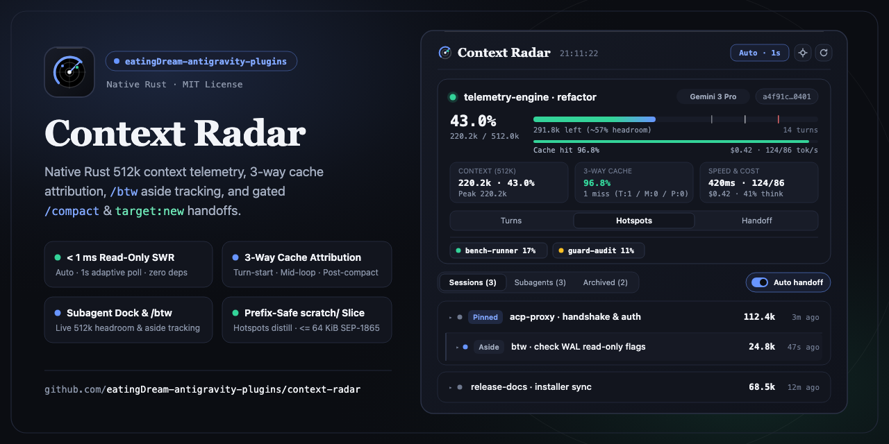

<div align="center">


# Context Radar MCP

**See how full your Antigravity context really is, why a turn got slow, and when it actually pays off to `/compact` or start fresh.**

[English](README.md) · [简体中文](README.zh-CN.md) · [Releases](https://github.com/eatingDream-antigravity-plugins/context-radar-mcp/releases) · [AI Guide](docs/ai-guide.md) · [llms.txt](llms.txt)

[](https://github.com/eatingDream-antigravity-plugins/context-radar-mcp/actions/workflows/ci.yml)
[](https://github.com/eatingDream-antigravity-plugins/context-radar-mcp/releases)

[](LICENSE)


</div>

## What It Is

- **What it is**: A local native Rust MCP server, live Antigravity side panel, and pure-protocol ACP thin client that tracks context budgets, attributes prompt-cache misses, distills history slices safely, and runs gated `/compact` or fresh-chat handoffs.
- **What it is not**: A cloud proxy, history mutator, or telemetry service — it never sends data off your machine and never rewrites live conversation logs.

## Features

- **Live 4-state telemetry & headroom**: Tracks main sessions and subagents (`ready`, `running`, `waiting`, `error`), remaining context tokens, KV cache hit rate, thinking vs. response share, Stream/E2E speed, and estimated cost.
- **Editorial-Warm side panel**: Dark-first zero-flash UI with a single focus hero, horizontal subagent dock, mini-bar turn hotspots, and clear **Pinned vs. Recent** session grouping.
- **3-way cache miss diagnostics**: Separates normal new-turn misses, mid-loop cache breaks (slow-turn TTL, spillover, model switch), and post-compact rebuilds, plus cross-model `/compact` warnings.
- **Prefix-safe `scratch/` distillation**: Saves concise digests of bloated turn ranges out-of-band so your live prompt KV prefix stays hot.
- **Gated `/compact` & fresh-chat handoffs**: Evaluates budget tiers, active subagents, and break-even turns before dispatching via official SEP-1865 `ui/message` or ACP v1 (`acp-proxy` / `acp-run`).
- **Optional session guardrails**: Prevents short shell commands from being backgrounded prematurely and injects optional workspace startup notes.

## Quick Start

Install the SHA-256 verified prebuilt binary (macOS Apple Silicon, macOS Intel, Linux x86_64):

```sh
curl -fsSL https://raw.githubusercontent.com/eatingDream-antigravity-plugins/context-radar-mcp/main/scripts/install.sh | sh
```

Reload Antigravity, open **Context Radar** in the side pane, or ask your agent: *"Why did the last few turns get slow?"* or *"Is it worth running `/compact` now?"*.

## For AI Agents

Context Radar ships machine-readable docs and a portable skill (`agentskills.io` compatible). Point any MCP-capable agent (Antigravity, Claude Code, Codex, Cursor, OpenCode) at:

```sh
npx skills add eatingDream-antigravity-plugins/context-radar-mcp
```

> **Agent prompt hint**: Read [`llms.txt`](llms.txt), [`skills/context-radar/SKILL.md`](skills/context-radar/SKILL.md), and [`docs/ai-guide.md`](docs/ai-guide.md) for full MCP tool schemas, ACP proxy/run workflows, settings, and CLI flags.

## Safety & Privacy

- **100% local & read-only**: Zero outbound network calls or telemetry; reads Antigravity SQLite ledgers with `SQLITE_OPEN_READ_ONLY` plus incremental WAL/JSONL tailing.
- **Atomic symlink-safe writes**: `scratch/` digests traverse directories via `O_NOFOLLOW` dirfd checks and atomic `0600` temp-file renames.
- **Fail-closed grants & ACP auth**: One-time handoff grants bind to `conversation_id` + `workspace` in `0600` files and never claim on persistence failure; headless `acp-run` cancels allow-only prompts unless `--auto-approve` is set.
- **Strict panel CSP**: Single self-contained HTML bundle (`default-src 'none'`), zero external assets, and zero `innerHTML` writes.

## Documentation

- [AI Agent & Operator Guide](docs/ai-guide.md) — MCP tools, ACP `acp-proxy`/`acp-run`, config & env vars, source build
- [Agent Skill (`SKILL.md`)](skills/context-radar/SKILL.md) — Portable workflow instructions for agents
- [LLM Index (`llms.txt`)](llms.txt) · [Contributor Guide](AGENTS.md) · [Settings Example](settings.example.json)
- [Changelog](CHANGELOG.md) · [Security](SECURITY.md) · [Contributing](CONTRIBUTING.md)

## License

Licensed under the [MIT License](LICENSE).
