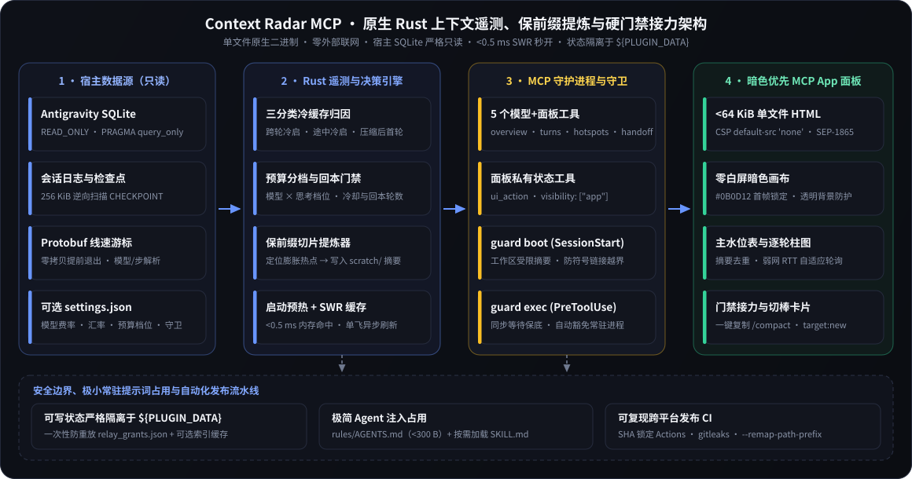

<div align="center">


# Context Radar MCP

**原生 Rust 打造的 Antigravity 上下文遥测引擎：三分类冷缓存归因、保前缀切片提炼、硬门禁 `/compact` 与官方 `target:new` 接力，以及原生执行守卫。**

[](https://github.com/eatingDream-antigravity-plugins/context-radar-mcp/actions/workflows/ci.yml)
[](https://github.com/eatingDream-antigravity-plugins/context-radar-mcp/releases)
[](LICENSE)


[English](README.md) | 简体中文


<sub>单文件原生 Rust 二进制，零运行时依赖，严格只读访问宿主 SQLite，内置暗色优先的 &lt; 45 KiB SEP-1865 MCP App 面板。</sub>

</div>

## 核心特性

- **启动后台预热与 `< 0.5 ms` SWR 秒开**：守护进程启动时即在后台预加载 `panel/dist/panel.html` 并将活跃宿主 SQLite 遥测预热至内存；`resources/read` 与 `context_radar_overview` 通过 Stale-While-Revalidate 瞬时返回 SSR 首帧，后台单飞异步刷新。
- **三分类冷缓存归因**：将每一次 KV 缓存未命中精准区分为 `turn_start_cold`（跨轮新用户输入）、`mid_loop_cold`（执行途中意外断前缀）或 `post_compact_cold`（压缩后首轮正常冷启），同步统计 TTFT、输出速度（tok/s）与单轮估算费用。
- **保前缀切片提炼**：通过 256 KiB 逆向 `CHECKPOINT` 扫描（`context_radar_hotspots`）快速定位历史膨胀热点，将冗余步骤区间提炼为 `< 600` token 摘要并持久化到会话 `scratch/` 目录，全程不破坏当前热 KV 缓存前缀。
- **硬门禁 `/compact` 与官方 `target:new` 接力**：综合评估模型 × 思考档位预算阈值、距上次检查点冷却轮数、近期冷重建保护、`running_subagent_count == 0` 以及经济回本轮数，校验通过后签发一次性防重放接力票据（`context_radar_prepare_handoff` → `context_radar_commit_handoff`）。
- **暖暗色零闪烁 MCP App 面板（`ui://context-radar-mcp/panel`）**：自包含 `< 45 KiB` 单文件 HTML（`default-src 'none'`，零外部链接），首帧锁定 `#141311` 暖黑画布并拦截透明 `--color-background-primary` 注入，支持宿主主题同步、主水位仪表盘、逐轮柱状趋势图、摘要去重与弱网 RTT 自适应轮询。
- **原生 Rust 执行守卫（`hooks.json`）**：`SessionStart`（`guard boot`）提供防符号链接越界的工作区受限摘要（未配置时静默返回 `{}`）；`PreToolUse(run_command)`（`guard exec`）自动抬升过低的同步等待超时，同时豁免 `IsDaemon: true`、`&`、`nohup`、监听进程与开发服务器。
- **极简常驻上下文占用**：纯 Markdown `rules/AGENTS.md`（`< 300 B`）配合按需加载的 `skills/context-radar/SKILL.md`，并将面板私有操作 `context_radar_ui_action` 严格隐藏为 `_meta.ui.visibility: ["app"]`。

## 架构

<p align="center"></p>

1. **宿主数据源（只读）**：严格以 `SQLITE_OPEN_READ_ONLY` + `PRAGMA query_only = ON` 打开 Antigravity SQLite；对会话日志执行逆向检查点扫描，并通过零拷贝提前退出 Protobuf 游标（`src/wire/pb_cursor.rs`）高速提取模型与步骤元数据。
2. **Rust 遥测与决策引擎（`src/engine/`）**：计算三分类冷缓存统计、模型 × 思考档位预算阈值、回本轮数与保前缀切片摘要，并维护后台预热的 SWR 内存缓存。
3. **MCP 守护进程与执行守卫（`src/rpc/`、`src/guard/`）**：提供标准 stdio JSON-RPC 工具（`daemon`），将所有可写状态（`relay_grants.json` 与可选 `index_cache.sqlite`）严格隔离于 `${PLUGIN_DATA}`，同时提供亚毫秒级生命周期钩子（`guard boot`、`guard exec`）。
4. **暖暗色 MCP App 面板（`panel/`）**：将 `bridge.js`、`view.js` 与 `theme.css` 打包为 `< 45 KiB` 单文件 HTML，支持同步 SSR 首帧挂载、就地 DOM 增量更新、按宿主能力动态显隐控件及防白屏透明背景过滤。

## 快速安装

### 一键安装（macOS 与 Linux）

自动从 GitHub Releases 下载对应系统架构的预编译插件包，校验 SHA-256 摘要，并以原子替换方式安装到 `${ANTIGRAVITY_PLUGINS_DIR:-$HOME/.gemini/config/plugins}/context-radar-mcp`：

```sh
curl -fsSL https://raw.githubusercontent.com/eatingDream-antigravity-plugins/context-radar-mcp/main/scripts/install.sh | sh
```

如需指定版本或自定义插件目录：

```sh
CONTEXT_RADAR_VERSION=v1.0.0 ANTIGRAVITY_PLUGINS_DIR=~/.gemini/config/plugins \
  curl -fsSL https://raw.githubusercontent.com/eatingDream-antigravity-plugins/context-radar-mcp/main/scripts/install.sh | sh
```

预编译支持目标：`aarch64-apple-darwin`、`x86_64-apple-darwin`、`x86_64-unknown-linux-gnu`。

### 从源码构建

环境要求：Rust 工具链（`cargo`），以及 Node.js 20+（仅重新打包 `panel/dist/panel.html` 与运行面板单元测试时需要）。

```bash
git clone https://github.com/eatingDream-antigravity-plugins/context-radar-mcp.git
cd context-radar-mcp

# 打包自包含 MCP App 面板（< 45 KiB）并运行面板测试
node panel/pack.mjs
node --test panel/panel.test.mjs

# 运行 Rust 单元测试、安全校验、SWR 与 stdio 端到端测试
cargo test --locked

# 构建剥离符号与本地路径的 LTO 发布二进制
RUSTFLAGS="--remap-path-prefix=$HOME=/build" cargo build --release --locked

# 可选：运行内置遥测、Protobuf 与守卫微基准测试
./target/release/context-radar-mcp bench
```

## Agent 集成与 Skill

Context Radar MCP 遵循最小侵入式 Antigravity 插件规范：

- **`rules/AGENTS.md`**（`< 300 B`，纯 Markdown）：轻量级常驻提示，告知 Agent 在排查上下文热点、评估压缩阈值或执行接力前按需加载技能。
- **`skills/context-radar/SKILL.md`**：按需加载的完整工作流指南，涵盖 KV 热前缀保护、局部切片提炼、硬门禁接力边界、子代理切棒与同步命令等待规范。
- **`hooks.json`**：接入 `context-radar-mcp guard boot`（`SessionStart`，未配置时静默 `{}`）与 `context-radar-mcp guard exec`（`PreToolUse(run_command)`）。

### MCP 工具一览

| 工具名称 | 可见性 | 用途 |
| :--- | :--- | :--- |
| `context_radar_overview` | 模型 + 面板（`aux_pane`、`global`） | 实时主会话与子代理快照、`if_digest` 去重与 SWR 首帧入口（`ui://context-radar-mcp/panel`） |
| `context_radar_turns` | 模型 + 面板 | 逐轮上下文 token、缓存命中率、三分类冷缓存归因、TTFT、输出速度与费用 |
| `context_radar_hotspots` | 模型 + 面板 | 256 KiB 逆向 `CHECKPOINT` 扫描定位膨胀热点，或将区间切片提炼写入 `scratch/` |
| `context_radar_prepare_handoff` | 模型 + 面板 | 评估模型 × 思考档位预算、冷却轮数、活跃子代理状态与压缩经济回本轮数 |
| `context_radar_commit_handoff` | 模型 + 面板 | 服务端硬门禁校验，签发一次性接力票据、一键 `/compact` 与 `target:new` 卡片（`ui://context-radar-mcp/handoff`） |
| `context_radar_ui_action` | 仅面板（`["app"]`） | 面板偏好持久化（`set_prefs`）与接力票据状态流转（`claim_grant`、`record_relay`、`dismiss_grant`） |

## 配置

默认无需任何配置文件，也不会自动创建用户配置。如需自定义模型费率、币种/汇率、预算分档或工作区守卫规则，可参考 [settings.example.json](settings.example.json) 创建 `~/.config/context-radar-mcp/settings.json`（完整结构见 [settings.schema.json](settings.schema.json)）。

| 环境变量 | 说明 | 默认值 |
| :--- | :--- | :--- |
| `CONTEXT_RADAR_CONFIG` | 自定义 `settings.json` 路径（设为 `none`/`off` 可禁用外部配置） | `~/.config/context-radar-mcp/settings.json` |
| `CONTEXT_RADAR_DATA_ROOT` | 宿主 Antigravity 数据根目录（严格只读） | `~/.gemini/antigravity` |
| `CONTEXT_RADAR_PLUGIN_DATA` | 隔离的可写插件数据目录（`--data-dir` 优先） | `${DATA_ROOT}/plugin_data/context-radar-mcp` |
| `CONTEXT_RADAR_DISABLE_DISK_CACHE` | 禁用插件数据目录下的可选 `index_cache.sqlite` | 未设置（`false`） |
| `CONTEXT_RADAR_PANEL_HTML` | 覆盖 `panel/dist/panel.html` 路径（`--panel-html` 优先） | `${PLUGIN_ROOT}/panel/dist/panel.html` |

## 安全与隐私边界

- **宿主数据库严格只读**：所有 Antigravity SQLite 均以 `SQLITE_OPEN_READ_ONLY` 与 `PRAGMA query_only = ON` 打开，绝不写入或阻塞宿主会话数据库。
- **可写状态完全隔离**：一次性防重放接力票据（`relay_grants.json`）及可选索引缓存严格写入 `--data-dir ${PLUGIN_DATA}`。
- **零遥测、零外联**：原生二进制不发起任何外部网络请求；内置 MCP App 面板执行 `default-src 'none'`，不含任何外部 URL 或远程脚本。
- **防路径穿越与符号链接越界**：`guard boot` 对配置的工作区状态文件执行规范化路径校验，拒绝逃逸工作区根目录的符号链接或相对路径，并强制截断字节上限。
- **供应链与构建卫生**：发布二进制使用 `RUSTFLAGS="--remap-path-prefix=$HOME=/build"` 消除本机路径，所有第三方 GitHub Actions 锁定 40 位 Commit SHA，CI 内置全历史 `gitleaks` 扫描与 `scripts/check_sanitized.sh`。

## 目录结构

```text
context-radar-mcp/
├── src/
│   ├── engine/             # 遥测聚合、三分类冷缓存归因、预算门禁、票据、提炼器与费率表
│   ├── ledger/             # 只读 SQLite 封装、可选索引缓存、日志逆向读取
│   ├── wire/               # 零拷贝提前退出 Protobuf 游标
│   ├── rpc/                # MCP stdio 协议、SWR 后台预热与工具分发
│   ├── guard/              # SessionStart 启动守卫与 PreToolUse 执行门禁
│   ├── settings.rs         # 可选配置热监听
│   └── main.rs             # CLI 入口（daemon、guard、bench、--version）
├── panel/
│   ├── bridge.js           # 轻量 SEP-1865 通信桥 + 防透明背景变量守卫
│   ├── view.js             # 单次挂载暖暗色界面、逐轮柱图与自适应轮询
│   ├── theme.css           # 暗色优先设计令牌 + 受控浅色主题
│   ├── pack.mjs            # 单文件 < 45 KiB HTML 打包器
│   └── panel.test.mjs      # CSP、防闪烁与透明背景守卫测试集
├── skills/context-radar/   # 按需加载的 SKILL.md 技能手册
├── rules/AGENTS.md         # 极简（< 300 B）常驻规则文件
├── scripts/                # install.sh、check_sanitized.sh
├── docs/                   # 架构图（中/英 SVG）与社交预览图
├── tests/                  # Rust 核心逻辑、安全边界、SWR 与 stdio E2E 测试
├── plugin.json             # Antigravity 插件清单
├── mcp_config.json         # MCP stdio 服务注册配置
├── hooks.json              # SessionStart 与 PreToolUse 钩子配置
├── settings.example.json   # 外部配置示例
└── settings.schema.json    # settings.json JSON Schema
```

## 参与贡献与许可

欢迎提交 Pull Request —— 分支规范与本地检查见 [CONTRIBUTING.md](CONTRIBUTING.md)，版本变更记录见 [CHANGELOG.md](CHANGELOG.md)，安全漏洞请按 [SECURITY.md](SECURITY.md) 私下报告。

本项目基于 [MIT 许可证](LICENSE) 开源。
