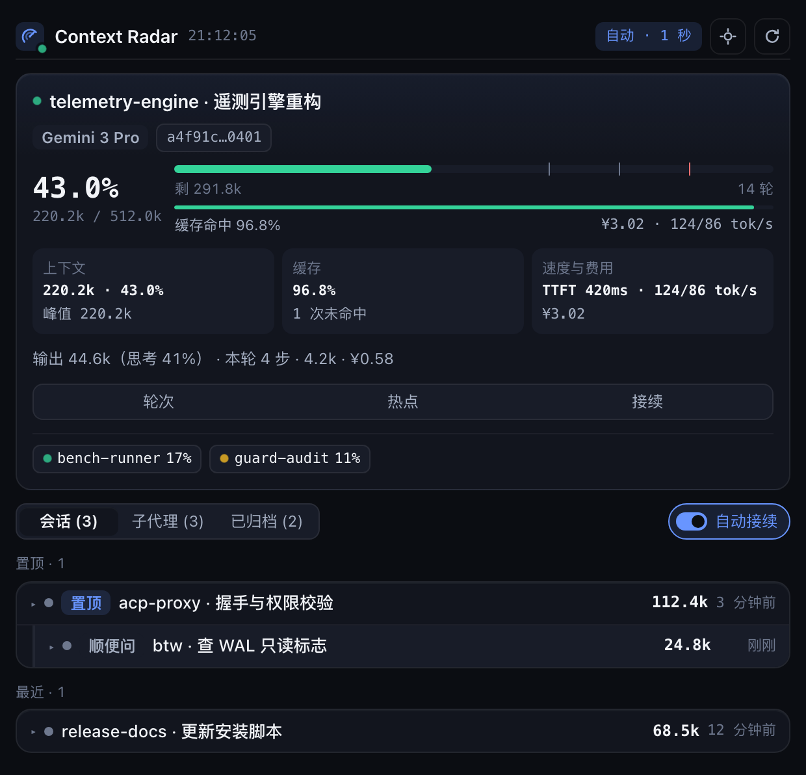

<div align="center">


# Context Radar (`context-radar-mcp`)

**在上下文撑满之前，先看清余量。**

Context Radar 在 Antigravity 侧边栏实时显示每个会话、子代理和顺便问的上下文占用、缓存命中率与费用。对话快满时，它会告诉你现在该执行 `/compact` 还是换新会话，并帮你写好接续说明。

[主页](https://contextradar.eatingdream.dev) · [English](README.md) | **简体中文** · [Releases](https://github.com/eatingDream-antigravity-plugins/context-radar/releases) · [AI 指南](docs/ai-guide.md) · [`llms.txt`](llms.txt)

[](https://github.com/eatingDream-antigravity-plugins/context-radar/actions/workflows/ci.yml)
[](https://github.com/eatingDream-antigravity-plugins/context-radar/releases)

[](LICENSE)

<br>

<picture>
  <source media="(prefers-color-scheme: dark)" srcset="docs/images/contextradar-overview-dark-zh.png">
  <source media="(prefers-color-scheme: light)" srcset="docs/images/contextradar-overview-light-zh.png">
  
</picture>

</div>

## 适合你吗？

- **适合**：经常在 Antigravity 里跑长对话或多子代理协作，想知道为什么突然变慢、缓存为什么断了、何时才该压缩或开新会话。
- **不需要**：平时只做几轮简短问答、上下文很少超过一半——Antigravity 默认体验已经足够，不必多开侧边栏。

## 你能直接看到与做到什么

| | |
| :--- | :--- |
| **实时余量与子代理总览** | 一眼看清主会话与子代理的运行状态（就绪/运行/等待/异常）、剩余上下文空间、思考占比、生成速度与估算费用。 |
| **定位突然变慢的真实原因** | 自动区分正常增长、中途断缓（慢轮过期、副本溢出、切换模型）与压缩后重建，并提前预警跨模型 `/compact` 导致的缓存失效。 |
| **不破缓存地清理历史冗余** | 找出拉爆上下文的具体轮次，把早期冗长记录旁路提炼到 `scratch/`，保住当前对话的热提示词缓存。 |
| **算清回本账再触发压缩** | 自动核对模型预算档位、活跃子代理与回本轮数，只在真正划算时执行 `/compact` 或新对话交接，也支持无头 CLI 自动托管。 |
| **100% 本地只读运行** | 原生 Rust 单文件，零外网请求、零遥测上报，只读读取本机 Antigravity 会话日志，绝不改写历史记录。 |

## 快速开始

```sh
curl -fsSL https://raw.githubusercontent.com/eatingDream-antigravity-plugins/context-radar/main/scripts/install.sh | sh
```

<sub>安装脚本自动校验发行版 SHA-256 · 在 Antigravity 内自动热刷新 MCP 服务（外部终端可加 `--reload`，跳过可加 `--no-reload`）· 支持 macOS（Apple Silicon / Intel）与 Linux `x86_64` · 可用 `CONTEXT_RADAR_VERSION=vX.Y.Z` 指定版本 · 随时可用 `... | sh -s -- --uninstall` 干净卸载。</sub>

重载 Antigravity 后在侧边栏打开 **Context Radar**，或直接问你的 Agent：

- *「刚才几轮为什么突然变慢了？」*
- *「哪几轮把上下文撑大了？现在执行 `/compact` 划算吗？」*

### 30 秒本地体验

直接用命令行测试本机只读遥测速度，或离线预览单文件面板：

```sh
~/.gemini/config/plugins/context-radar-mcp/bin/context-radar-mcp bench --iterations 5
```

或在源码目录中：

```sh
npm --prefix panel ci --ignore-scripts && npm --prefix panel run build && open panel/dist/panel.html
```

## 面向 AI Agent

项目内置机器可读文档与通用 Skill（兼容 `agentskills.io`），支持 Antigravity、Claude Code、Codex、Cursor、OpenCode 等任意 MCP 客户端：

```sh
npx skills add eatingDream-antigravity-plugins/context-radar
```

> **给 Agent 的提示**：完整的 MCP 工具参数表、ACP 代理与无头运行用法、配置项及源码构建步骤见 [`llms.txt`](llms.txt)、[`skills/context-radar/SKILL.md`](skills/context-radar/SKILL.md) 与 [`docs/ai-guide.md`](docs/ai-guide.md)。

## 安全与隐私

- **零联网、零遥测**：以只读方式读取本地会话账本，不向外部服务器上传提示词、路径或统计数据。
- **隔离且防符号链接的本地落盘**：`scratch/` 摘要与单次交接票据严格绑定当前会话与工作区，使用仅本机用户可读写（`0600`）的原子写入。
- **离线自包含面板**：单文件 HTML 面板采用严格 `default-src 'none'` CSP，零外链资源，零 `innerHTML` 写入。

## 文档索引

- [AI Agent 与配置指南](docs/ai-guide.md) — MCP 工具全表、ACP `acp-proxy` / `acp-run`、环境变量与源码构建
- [通用 Agent Skill（`SKILL.md`）](skills/context-radar/SKILL.md) · [LLM 索引（`llms.txt`）](llms.txt)
- [配置示例](settings.example.json) · [协作指南](AGENTS.md) · [更新日志](CHANGELOG.md) · [安全策略](SECURITY.md) · [贡献指南](CONTRIBUTING.md)

## Antigravity 插件套件

隶属于 [Antigravity Plugins](https://github.com/eatingDream-antigravity-plugins) 套件：**Context Radar** · [Clam Guard](https://github.com/eatingDream-antigravity-plugins/clam-guard) · [Remote Cast](https://github.com/eatingDream-antigravity-plugins/remote-cast) · [Colab Deck](https://github.com/eatingDream-antigravity-plugins/colab-deck) · [Panel Kit](https://github.com/eatingDream-antigravity-plugins/panel-kit)。

## 许可证

本项目基于 [MIT License](LICENSE) 开源。
